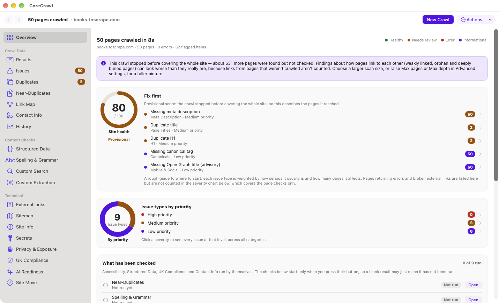

<h1> CoreCrawl</h1>

**Free, private website audits for Mac.** CoreCrawl crawls your website and shows you what is broken, missing or holding it back: broken links, redirect chains, missing titles, repeated titles and descriptions, indexing problems and more. It runs on your Mac. No account, no subscription, nothing locked behind a paywall.

### [Download CoreCrawl 2.25.6 (free)](https://github.com/tech-reality/CoreCrawl-releases/releases/latest/download/CoreCrawl.dmg)

For Apple silicon Macs (M1 or later), macOS 13 or later · by [Tech Reality](https://tech-reality.co.uk) · [Website](https://tech-reality.github.io/CoreCrawl-releases/)

## Why I made it

I made CoreCrawl because I was frustrated with so many other apps out there just not having the features I wanted at the price I wanted them at.. that being FREE! Some website audit tools wanted money for the genuinely useful parts, and others were too complicated for a beginner to get anywhere with. I wanted something free that anyone running a website could pick up and understand.

— Gordon, Tech Reality

## What it checks

- Broken links, redirect chains and server errors
- Titles, descriptions, headings and canonical tags
- Repeated titles and descriptions, and near-duplicate page text
- Pages with few or no links pointing to them (among the pages the crawl reached), with an interactive link map: spotlight problem pages, search for a page, see the route to it and preview it beside the map
- Accessibility, privacy and exposed-secrets checks
- UK cookie-consent and privacy-notice checks
- AI crawler access and `llms.txt`
- A health score and a "Fix first" list, with every finding explained in plain English
- A live Overview while it scans: a chart of how pages are turning out, running counts of problems and a progress bar
- Results you can narrow to Loads OK, Redirects, Errors, Blocked or pages with issues, with a preview of any page beside them

## Install

1. [Download `CoreCrawl.dmg`](https://github.com/tech-reality/CoreCrawl-releases/releases/latest/download/CoreCrawl.dmg) and open it.
2. Drag **CoreCrawl** into your Applications folder.
3. The first time you open it, macOS says it cannot verify the app. That is because it has not been through Apple's automatic security check for downloaded apps (notarisation). The **How to Open CoreCrawl** guide inside the disk image shows every click, and you only have to do it once.

To check the download is untouched, compare its SHA-256 checksum (in [this small file](https://github.com/tech-reality/CoreCrawl-releases/releases/latest/download/CoreCrawl.dmg.sha256.txt)) with the result of `shasum -a 256 CoreCrawl.dmg`.

## Guides

- [User Guide](https://github.com/tech-reality/CoreCrawl-releases/releases/latest/download/CoreCrawl-User-Guide.pdf) (PDF, 31 pages): every tab, what the messages mean and what to do next
- [Start Here](https://github.com/tech-reality/CoreCrawl-releases/releases/latest/download/START-HERE.pdf) (one page)
- [Example report](https://github.com/tech-reality/CoreCrawl-releases/releases/latest/download/Example-CoreCrawl-Report.pdf): a real audit of a public test site, made with an earlier version, so some wording differs

## Good to know

- It reads the HTML a site sends and does not run JavaScript, so a site built entirely in the browser can look empty to it. The app warns you when it thinks that has happened.
- Findings are prompts to take a look, not verdicts.
- Only audit sites you own or have permission to test.
- There is no Google Analytics or Search Console connection, and no page-speed testing. It is not a security scanner.
- Your results stay on your Mac. Nothing is sent to Tech Reality.
- How it is made: I designed and directed CoreCrawl, and I test it by hand before each release. It was written with Claude (Anthropic) and reviewed with Codex (OpenAI).

## Licence and support

CoreCrawl is free to use for personal, business and client work, but it is not open source. Please do not re-upload, bundle or sell it; share [this page](https://github.com/tech-reality/CoreCrawl-releases/releases/latest) instead. The full terms are in the [licence](https://github.com/tech-reality/CoreCrawl-releases/releases/latest/download/CoreCrawl-Licence.txt), and the open-source software it contains is listed in the [third-party notices](https://github.com/tech-reality/CoreCrawl-releases/releases/latest/download/Third-Party-Notices.txt).

Ideas, problems or questions? In the app choose **Help › Suggest a Feature or Report a Problem…**, or email [support@tech-reality.co.uk](mailto:support@tech-reality.co.uk). Nothing is sent from the app itself, and it never includes the websites you scan.

If CoreCrawl saves you time, there is an optional [coffee link](https://buymeacoffee.com/emq5t8mlml). There is no pressure.
